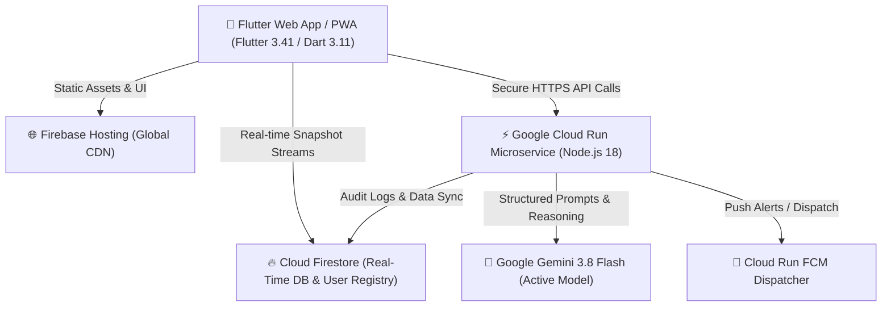

# Serbuin — Smart Loyalty App 🚀

**Serbuin** is an AI-powered, next-generation customer loyalty & digital stamp card platform built for the **AI Builder Cup 2026**. Powered by **Flutter 3.41+ (Dart 3.11+)**, **Google Cloud Run**, **Google Gemini 3.8 Flash**, **Cloud Firestore**, and **Firebase Hosting**.

---

## 💡 The Problem We Solve

1. **For Merchants (The Silent Churn Problem):** Small food & beverage businesses lose repeat customers without noticing. Paper stamp cards get lost or forged, and give owners no customer data. Owners can't tell which regulars are drifting away or what targeted offer would bring them back.
2. **For Customers (App Fatigue & Paper Clutter):** Customers hate carrying bulging stacks of paper cards that get lost or left at home. At the same time, customers refuse to install a separate mobile app and create a separate account for every neighborhood café and bakery.
3. **The Serbuin Solution:** A **Universal Digital Wallet** (zero-install Web App / PWA) holding all local merchant cards in one swipeable stack, coupled with an **AI Retention Co-Pilot** that drafts programs and predicts member churn with surgical win-back vouchers.

---

## 🌟 Key Highlights & Technology Stack

| Component | Technology | Version / Specification | Purpose |
| :--- | :--- | :--- | :--- |
| **Frontend** | Flutter Web (Dart) | **Flutter 3.41.1** • **Dart 3.11.0** | Universal mobile-first web wallet with smooth 60fps stacked card animations, dark obsidian theme, and instant camera QR scanner. |
| **Generative AI** | Google Gemini API | **Gemini 3.8 Flash** | Powers the **AI Loyalty Program Architect** and **AI Member Churn Risk Scanner & Win-back Engine** with structured JSON output and multi-model fallback cascade (`gemini-3.8-flash` $\to$ `gemini-2.5-flash` $\to$ `gemini-2.0-flash`). |
| **Backend API** | Google Cloud Run | **Node.js 18+ (Express)** | Serverless microservice orchestrating Gemini prompts, FCM push dispatches, and analytics without exposing API keys in client code. |
| **User Registry** | Cloud Firestore | **Firestore-Based User Registry** | Serverless role-based session and profile registry (`users` collection) with password verification and cross-device sync. |
| **Database** | Cloud Firestore | **Cloud Firestore NoSQL** | Real-time multi-client state synchronization for programs, members, vouchers, stamps, and activity feeds. |
| **Hosting & CDN** | Firebase Hosting | **Firebase Hosting Global CDN** | Global edge distribution, SSL termination, and client-side SPA routing. |

---

## 🏛️ System Architecture



---

## 🧠 Gemini 3.8 Flash AI Features

### 1. 🪄 AI Loyalty Program Architect (`/api/ai/generate-program`)
Merchants specify a simple prompt and goal (e.g., *"Menarik Customer Baru"*, *"Cari Untung Besar"*, or *"Biar Rame Saja"*).
**Gemini 3.8 Flash** analyzes behavioral retention dynamics and generates:
- Engaging program title, tagline, and business category
- Optimal stamp milestone count (e.g., 5 to 8 stamps)
- Curated Terms & Conditions in Indonesian
- High-value reward definition (e.g., *"Free Artisan Pour-over on 6th Visit"*)
- Deep strategic rationale and merchant financial margin analysis (e.g., locked customer basket size vs. reward COGS)
- Thematic color gradient and vector icon identifier

### 2. 🛡️ AI Churn Risk Scanner & Win-back Vouchers (`/api/ai/scan-churn`)
Monitors customer dormancy days, visit cadence, and stamp progress:
- **Risk Level Evaluation**: `HIGH`, `MEDIUM`, or `LOW` risk tiers with 0–100 risk score
- **Automated Diagnosis**: Precise reason for inactivity (e.g., *"Customer has been absent for 36 days despite holding 5/8 stamps"*).
- **Personalized Win-back Voucher**: Tailored comeback incentive calibrated around the customer's favorite menu item.
- **Merchant Strategy Explanation**: Rationale explaining why this specific discount recovers the customer while preserving operating margins.
- **1-Click Dispatch**: Merchant dispatches the voucher instantly to the customer's wallet.

---

## 📱 User Roles & Capabilities

### 👤 Customer Role (Universal Wallet)
- **Universal Stacked Cards Wallet**: Swipeable card stack holding passes across multiple independent merchants in one place without downloading separate apps.
- **Dynamic Security QR Code**: Time-decaying rotating QR code for secure in-store stamp accumulation and voucher redemption.
- **Live Stamp Grid & Completion**: Interactive stamp slots with animated completion milestones. Claiming a reward sets the card to "Completed" and unlocks subsequent programs.
- **Voucher Wallet**: Real-time counter badge and active promotional vouchers.
- **Recent Activity Feed**: Real-time log of stamps earned, vouchers claimed, and programs joined.

### 🏪 Merchant Role (Growth & Retention)
- **Real-Time Analytics Dashboard**: Live member count, customer retention rate %, and total claimed perks.
- **Active Programs Deck**: Visual card stack with stamp trackers and detail views (max 3 active programs).
- **Smart Member Directory**: Bottom-sheet filter sorting members by churn risk (`High`, `Medium`, `Low`) or program.
- **Universal Scanner**: Floating scan button with camera viewfinder to award stamps or redeem vouchers in < 2 seconds.
- **Mock Data Generator**: Interactive sandbox enabling merchants and judges to simulate 10+ customer lifecycles and test AI churn workflows instantly.

---

## 🚀 Deployment Instructions

### Prerequisites
1. **Google Cloud SDK**: [Download & install gcloud CLI](https://cloud.google.com/sdk/docs/install)
2. **Node.js 18+** & npm
3. **Flutter SDK 3.41+** & **Dart 3.11+**

### 1. Deploy Cloud Run Microservice
```bash
# Navigate to backend directory
cd backend-cloud-run

# Set your Gemini API Key in your environment
set GEMINI_API_KEY=YOUR_GEMINI_API_KEY

# Run deployment script (uses gemini-3.8-flash)
deploy.bat

# Or manually via gcloud:
gcloud run deploy serbuin-backend \
  --source . \
  --region us-central1 \
  --project serbuin-smart-loyalty-app \
  --set-env-vars GEMINI_API_KEY=%GEMINI_API_KEY%,PROJECT_ID=serbuin-smart-loyalty-app,PROJECT_NUMBER=398979153007,GEMINI_MODEL=gemini-3.8-flash \
  --allow-unauthenticated
```

### 2. Deploy Flutter Web App & Firestore Rules
```bash
# Build production web bundle
flutter build web --release

# Deploy to Firebase Hosting and Firestore
cmd /c "npx --yes firebase-tools deploy --project serbuin-smart-loyalty-app"
```

---

## 🛠️ Local Development & Testing

```bash
# Verify environment & dependencies
flutter doctor
flutter analyze

# Run Flutter Web locally
flutter run -d chrome

# Run Cloud Run backend locally
cd backend-cloud-run
npm install
node server.js
```

---

## 🌐 Live Product & Links

* **Live Web App:** [https://serbuin-smart-loyalty-app.web.app](https://serbuin-smart-loyalty-app.web.app/)
* **Cloud Run Backend:** `https://serbuin-backend-398979153007.us-central1.run.app`
* **GitHub Repository:** [https://github.com/jonatanprim/serbuin-smart-loyalty-app](https://github.com/jonatanprim/serbuin-smart-loyalty-app)

---

## 📄 License
Created for **AI Builder Cup 2026** by Team Serbuin.
