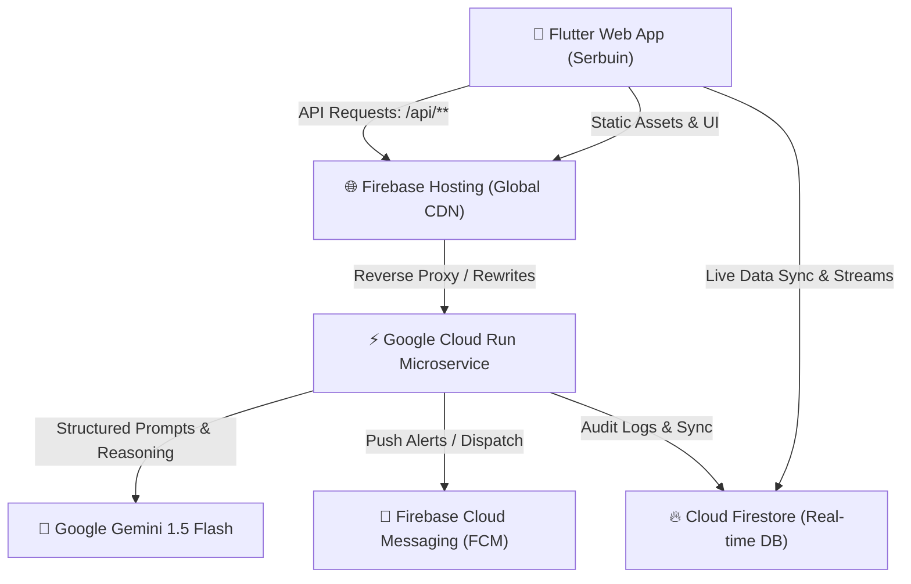

# Serbuin — Smart Loyalty App 🚀

**Serbuin** is an AI-powered, next-generation customer loyalty & digital stamp card platform built for the **AI Builder Cup**. Powered by **Flutter Web**, **Google Cloud Run**, **Google Gemini 1.5 Flash**, **Cloud Firestore**, and **Firebase Hosting**.

---

## 🌟 Key Highlights & Technology Stack

| Component | Technology | Purpose |
| :--- | :--- | :--- |
| **Frontend** | Flutter Web (Dart) | Responsive mobile-first progressive web application with obsidian dark theme, neon accents, and responsive viewport wrapper. |
| **Generative AI** | Gemini 1.5 Flash API | Powers the **AI Loyalty Program Architect** and the **AI Churn Risk & Retention Voucher Engine**. |
| **Backend API** | Google Cloud Run (Node.js Express) | Serverless microservice orchestrating Gemini prompts, FCM push notifications, and analytics processing without exposing API keys. |
| **Database** | Cloud Firestore | Real-time multi-client state synchronization for loyalty programs, members, vouchers, stamps, and activity feeds. |
| **Hosting & CDN** | Firebase Hosting | Ultra-fast global CDN with integrated rewrites routing `/api/**` directly to Cloud Run to eliminate CORS. |

---

## 🏛️ System Architecture



---

## 💡 Gemini AI Features

### 1. 🪄 AI Loyalty Program Architect (`/api/ai/generate-program`)
Merchants can input a simple goal (e.g. *"Boost weekday lunch traffic for a sushi bar"* or *"Win back students for a boba shop"*). 
Gemini 1.5 Flash analyzes consumer behavioral patterns and generates:
- Engaging program title & marketing tagline
- Optimal target stamps count (e.g. 6 stamps)
- Compelling reward description (e.g. *"Complimentary Salmon Roll on 5th Visit"*)
- Expiry duration and curated thematic color gradients (e.g. Emerald, Amber, Violet, Rose)
- Editable preview before publishing (max 3 active cards per merchant)

### 2. 🧠 AI Churn Risk Scanner & Win-back Vouchers (`/api/ai/scan-churn`)
Scans member visit frequency, recency, and stamp milestones to diagnose churn probability:
- **Risk Level Evaluation**: `HIGH`, `MEDIUM`, or `LOW`
- **Predictive Reason**: Detailed reasoning (e.g. *"Inactive for 28 days with 4 stamps; high likelihood of abandonment"*).
- **Recommended Win-back Voucher**: Dynamic discount code & incentive (e.g. `COMEBACK30` for 30% off).
- **1-Click Dispatch**: Merchant can send targeted vouchers instantly, triggering FCM notifications and live Firestore record updates.

---

## 📱 Role Capabilities

### 🏪 Merchant Role
- **Real-Time Analytics Dashboard**: Total Members, Customer Retention Rate %, and Total Claimed Rewards.
- **Active Programs Deck**: Visual card stack with stamp trackers and detail views. Deletion is automatically protected if members hold active stamps.
- **Smart Member Directory**: Filter by loyalty program, status (`Active`, `Completed`, `Expired`), or run AI Churn Analysis per member.
- **Universal Scanner**: Floating scan button to validate customer profile QR codes, award stamps, or redeem vouchers in real-time.
- **Merchant Profile**: Business metadata editor, working hours, and built-in interactive "How to Use" guide.

### 👤 Customer Role
- **Stacked Digital Stamp Cards**: Interactive loyalty card wallet sorted with most recent stamp in front.
- **Live Stamp Grid & Redemption**: Interactive visual stamp tracker with animated completion milestones and 1-click reward claiming.
- **Dynamic Security QR Code**: Customer profile and voucher redemption with dynamic 2-minute auto-refresh security counters.
- **Voucher Wallet**: Real-time counter badge and active voucher list.
- **Recent Activities Feed**: Real-time log of stamps earned, vouchers claimed, and programs joined.

---

## 🚀 Deployment Instructions

### Prerequisites
1. **Google Cloud SDK**: [Download & install gcloud CLI](https://cloud.google.com/sdk/docs/install)
2. **Node.js 18+** & npm
3. **Flutter SDK 3.x+**

### 1. Deploy Cloud Run Microservice
```bash
# Navigate to backend directory
cd backend-cloud-run

# Run the pre-configured deployment script
deploy.bat
# Or manually via gcloud:
gcloud run deploy serbuin-backend \
  --source . \
  --region us-central1 \
  --project serbuin-smart-loyalty-app \
  --set-env-vars GEMINI_API_KEY=YOUR_GEMINI_API_KEY,PROJECT_ID=serbuin-smart-loyalty-app,PROJECT_NUMBER=398979153007 \
  --allow-unauthenticated
```

### 2. Deploy Flutter Web App & Firestore Rules
```bash
# Build production bundle and deploy
deploy-hosting.bat
# Or manually via Firebase CLI:
flutter build web --release
npx firebase-tools deploy --project serbuin-smart-loyalty-app
```

---

## 🛠️ Local Development & Testing

```bash
# Run local Flutter Web server
flutter run -d chrome

# Or run release preview server
node serve_web.js
# Access at http://127.0.0.1:8080
```

---

## 📄 License
Created for **AI Builder Cup 2026** by the Serbuin Team.
